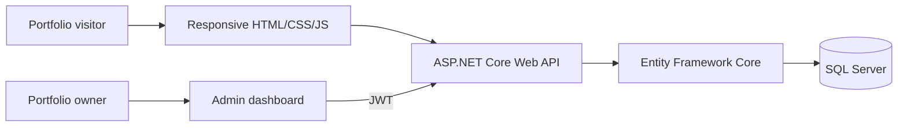

<div align="center">

# Portfolio Command Center

### A responsive personal portfolio connected to a secured ASP.NET Core dashboard

`HTML5` · `CSS3` · `JavaScript` · `ASP.NET Core 8` · `JWT` · `EF Core` · `SQL Server`

</div>

## Overview

This project combines a public portfolio website with an authenticated administration dashboard. Portfolio content, skills, projects, contact messages, and dashboard statistics are managed through an ASP.NET Core Web API backed by SQL Server.

## Highlights

- Responsive public portfolio with About, Services, Skills, Projects, Team, and Contact sections.
- Login and registration backed by JWT authentication and BCrypt password hashing.
- Dashboard statistics for projects, skills, messages, and portfolio activity.
- Project CRUD operations from the administration interface.
- Contact-message submission and dashboard inbox.
- Entity Framework Core migrations and seeded development data.
- Swagger/OpenAPI documentation for backend endpoints.

## Application flow



## API areas

| Area | Capabilities |
|---|---|
| Authentication | Register and login |
| Projects | List, create, update, and delete projects |
| Messages | Submit and retrieve contact messages |
| Dashboard | Statistics, projects, messages, and skills |

## Project structure

```text
├── PortfolioDashboard/            ASP.NET Core backend
│   ├── Controllers/               API endpoints
│   ├── Services/                  Auth and dashboard business logic
│   ├── Models/                    User, Project, Skill, Message, Stats
│   ├── Data/                      DbContext and seed initialization
│   └── Migrations/                EF Core migrations
└── Responsive Portfolio Website/  Public portfolio and admin dashboard UI
    ├── index.html                 Portfolio experience
    ├── dashbord.html              Management dashboard
    ├── style.css / dashbord.css   Responsive styling
    └── script.js / dashbord.js    API integration and interactions
```

## Run locally

### Requirements

- .NET 8 SDK
- SQL Server LocalDB or SQL Server
- A modern browser

```bash
git clone https://github.com/MostafaMedhat19/Responsive-and-dynamic-Portfolio-Website.git
cd Responsive-and-dynamic-Portfolio-Website/PortfolioDashboard
dotnet restore
```

Store database and JWT configuration outside source control:

```bash
dotnet user-secrets init
dotnet user-secrets set "ConnectionStrings:DefaultConnection" "YOUR_SQL_SERVER_CONNECTION"
dotnet user-secrets set "Jwt:Secret" "YOUR_LONG_RANDOM_SIGNING_KEY"
dotnet user-secrets set "Jwt:Issuer" "https://localhost:7170"
dotnet user-secrets set "Jwt:Audience" "https://localhost:7170"
dotnet ef database update
dotnet run
```

Serve the `Responsive Portfolio Website` directory with a local web server and update the JavaScript API base URL if the backend starts on a different port.

## Development roadmap

- Centralize the duplicated API base URL in one configuration file.
- Add integration tests for authentication and project CRUD.
- Add a hosted live demo and deployment workflow.
- Store production secrets in the deployment platform rather than `appsettings.json`.
- Improve validation, error states, and token-expiration handling.

## Author

[Mostafa Medhat](https://github.com/MostafaMedhat19)
